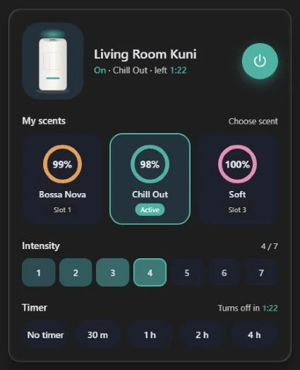
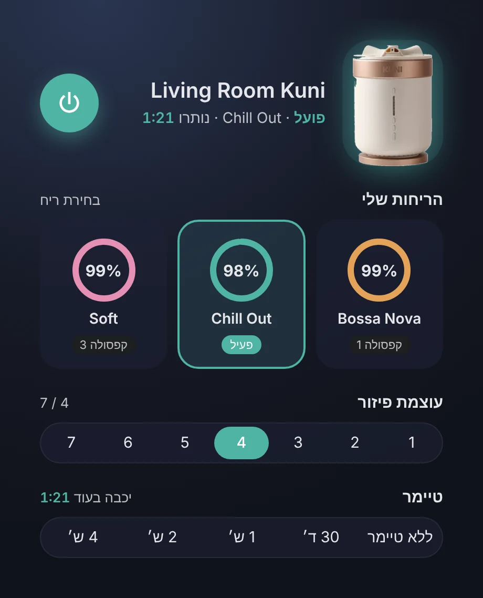
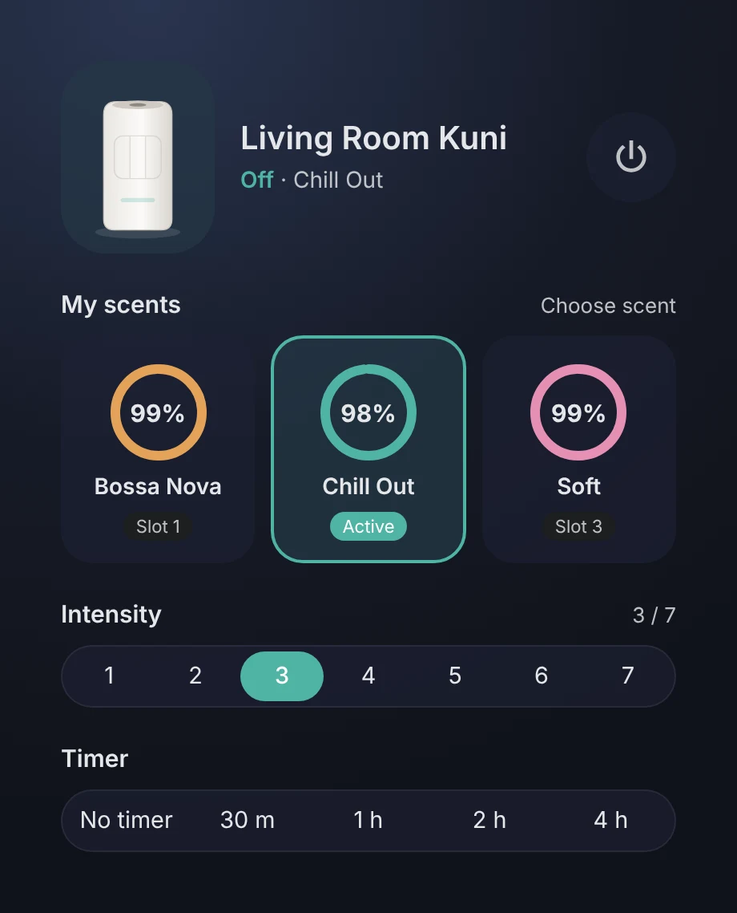
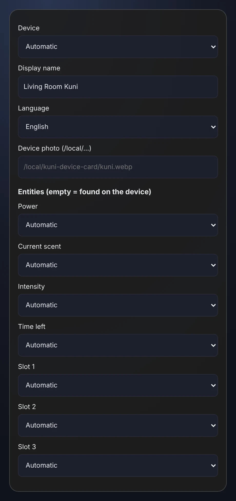

# Kuni Device Card

[](https://my.home-assistant.io/redirect/hacs_repository/?owner=matanmesika&repository=kuni-device-card&category=plugin)
[](https://github.com/matanmesika/kuni-device-card/releases/latest)

A Home Assistant dashboard card for the **Kuni** scent diffuser, built on the [Kuni integration](https://github.com/taltaub22/Kuni-HomeAssistant). Power, scent, intensity and timer in one card, in English or Hebrew.

## Screenshots

Captured from the card with the scents and fill levels of a real Kuni in Home Assistant. The running state (intensity 4, 1:21 left) shows what the card looks like while the diffuser runs.

| Running | Hebrew | Off |
| :---: | :---: | :---: |
|  |  |  |

## Features

- **Device header:** the diffuser, its name, on/off state, active scent and a live timer countdown, with a large power button.
- **My scents:** one tile per cartridge with a ring for how much is left (green, amber under 50%, red under 20%). Tap a tile to switch to that scent.
- **Intensity:** the seven device levels in one segmented bar.
- **Timer:** no timer, 30 min, 1 h, 2 h or 4 h, using the `kuni.set_timer` service.
- **Visual editor** for the device, name, language, photo and every entity.
- Hebrew (right to left) and English, light and dark themes, phone-sized touch targets.

## Requirements

The **[Kuni integration](https://github.com/taltaub22/Kuni-HomeAssistant)**, installed and connected to your diffuser. The card reads its entities and uses its `kuni.set_timer` service.

## Installation

### HACS (recommended)

[](https://my.home-assistant.io/redirect/hacs_repository/?owner=matanmesika&repository=kuni-device-card&category=plugin)

1. Click the button above, or in **HACS → ⋮ → Custom repositories** add `https://github.com/matanmesika/kuni-device-card` with type **Dashboard**.
2. Find **Kuni Device Card** and choose **Download**.
3. Reload the browser (on the phone app: close and reopen it).

### Manual

Copy `dist/kuni-device-card.js` to `<config>/www/kuni-device-card/`, then add `/local/kuni-device-card/kuni-device-card.js` as a **JavaScript module** under **Settings → Dashboards → ⋮ → Resources**.

## Setup

### Automatic

Add the card from the dashboard editor (**Add card → Kuni Device Card**), or with YAML:

```yaml
type: custom:kuni-device-card
```

The card finds your Kuni in the device registry and connects to its entities by their unique IDs, so renaming entities doesn't break it. With more than one Kuni, choose one with `device_id` (the editor lists them).

### Manual (visual editor or YAML)

| Visual editor |
| :---: |
|  |

In the editor you can choose the device, name, language and photo, and pick any entity yourself. Anything left on *Automatic* stays connected to the device.

```yaml
type: custom:kuni-device-card
device_id: 0123456789abcdef0123456789abcdef
name: Living Room Kuni
language: he
image: /local/kuni-device-card/kuni.webp
scent_colors:
  Soft: "#e58fb4"
entities:
  power: switch.living_room_kuni_power
  intensity: number.living_room_kuni_intensity
```

### Options

| Option | Default | Description |
| --- | --- | --- |
| `device_id` | automatic | The Kuni device. Needed only with more than one Kuni. |
| `entity` | — | Any entity of the Kuni, as another way to choose the device. |
| `name` | device name | Name shown in the header. |
| `language` | Home Assistant language | `he` or `en`. |
| `image` | built-in drawing | Your own device photo (`/local/…`, `/api/…` or `/hacsfiles/…`). A transparent background works best. |
| `scent_colors` | built-in colours | Colour per scent name, e.g. `{Soft: "#e58fb4"}`. Used for the ring, the active tile and the glow while it runs. |
| `entities` | automatic | Per-role entity overrides (see below). |

### Entities the card uses

All of them come from the Kuni integration and are found automatically.

| Role | Domain | Used for |
| --- | --- | --- |
| `power` | switch | On/off and the power button |
| `scent` | select | The active scent; tapping a tile selects it |
| `intensity` | number | The intensity bar (1–7) |
| `time_left` | sensor | The timer countdown (seconds) |
| `slot_1`, `slot_2`, `slot_3` | sensor | Fill level (%) and scent name of each cartridge |

The timer buttons call `kuni.set_timer` with the Kuni's device ID.

## Troubleshooting

- **"No Kuni device found":** the integration isn't loaded, or you have more than one Kuni. Pick a device in the editor or set `device_id`.
- **A tile or control is disabled:** the matching entity is unavailable or disabled. Enable it under *Settings → Entities*, or pick another entity in the editor.
- **An old version still shows after an update:** reload the browser, or close and reopen the phone app.

## Tests

`node --test tests/test_kuni_card.cjs`

## License

[MIT](LICENSE) © 2026 Matan Mesika

This is an unofficial project, not affiliated with Kuni.

---

## עברית — בקצרה

כרטיס ל־Home Assistant למפזר הריח **Kuni**: הפעלה, בחירת ריח, עוצמה וטיימר, בעברית או באנגלית.

**התקנה:** HACS → Custom repositories → `https://github.com/matanmesika/kuni-device-card` (סוג Dashboard) → Download, ואז רענון הדפדפן.

**הגדרה אוטומטית:** `type: custom:kuni-device-card`. הכרטיס מוצא לבד את המכשיר ואת כל הישויות שלו.

**הגדרה ידנית:** בעורך הוויזואלי בוחרים מכשיר, שם, שפה, תמונה, ואת כל ישות בנפרד (הפעלה, ריח פעיל, עוצמה, זמן נותר, וכל אחת משלוש הקפסולות). מה שנבחר ידנית גובר על הזיהוי האוטומטי.

נדרשת האינטגרציה [Kuni](https://github.com/taltaub22/Kuni-HomeAssistant).
